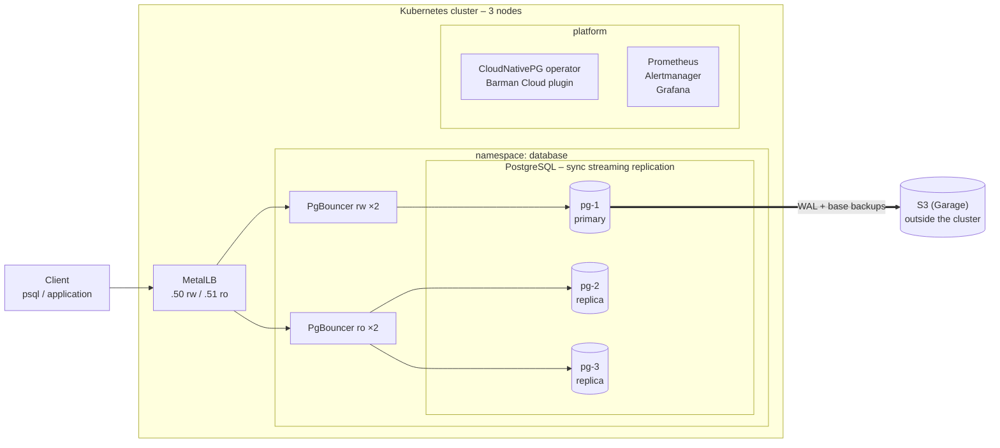

# PostgreSQL on on-premise Kubernetes

Highly available PostgreSQL running on a three-node k3s cluster, managed by the CloudNativePG operator.
The setup covers synchronous replication with automatic failover, continuous backup to S3-compatible
storage outside the cluster with point-in-time recovery, connection pooling with PgBouncer, and monitoring
with Prometheus. All Kubernetes resources are deployed declaratively with Helm and helmfile.

## Architecture



| Layer | Component | Purpose |
|---|---|---|
| Kubernetes | any distribution, 3+ nodes (tested: k3s with embedded etcd) | runs the database and the platform components |
| Storage | local disks (tested: k3s `local-path`) | local disk per node; HA is provided by PostgreSQL replication |
| Load balancing | MetalLB, L2 mode | stable external IPs for `LoadBalancer` services |
| Database | CloudNativePG 1.30, PostgreSQL 18 | failover, switchover, rolling updates, TLS, managed roles |
| Backup | Barman Cloud plugin → Garage (S3) | continuous WAL archiving, daily base backups, PITR |
| Logical backup | `pg_dump` CronJob → Garage (S3) | single-table restores, migrations between major versions |
| Connection pooling | PgBouncer (CNPG `Pooler`), transaction mode | protects the database from connection storms |
| Monitoring | kube-prometheus-stack | metrics, alert rules for the database and backups |
| Deployment | Helm + helmfile, pinned chart versions | one command, reproducible, `helmfile diff` before changes |

### Design decisions

**High availability.** Three instances, each on a different node (required pod anti-affinity).
Synchronous replication with `ANY 1` quorum: a commit is acknowledged once at least one replica has
flushed the WAL, so losing the primary does not lose committed transactions. `dataDurability: preferred`
keeps the primary writable if no healthy replica is left. Failover is performed by the operator; the
`pg-rw` service follows the current primary through pod labels.

**Storage.** Each instance has two volumes on the node's local disk: one for data and one for WAL.
Local disks give the best write latency and avoid replicating data twice (once by PostgreSQL, once by
the storage layer). The trade-off is that an instance is bound to its node; if a node is lost permanently,
the replica is rebuilt from the primary on another node.

**Backups.** WAL segments are archived continuously to S3 and a full base backup is taken daily from a
replica. Together they allow recovery to any point in time within the 14-day retention window. Restores
always go to a new cluster, never over the running one. The S3 storage runs outside the Kubernetes cluster,
so losing the cluster does not lose the backups. A nightly `pg_dump` runs as a dedicated `backup` role
with `pg_read_all_data`.

**Scaling.** The database is not autoscaled: only the primary accepts writes and a new replica requires
a full copy of the data. Connections are scaled with PgBouncer (stateless, can be scaled independently),
reads with additional replicas behind the `-ro` services, and writes vertically. All changes are made
in `values/postgres.yaml` and applied with helmfile.

**Exposure.** Applications inside the cluster use the `pg-rw` / `pg-ro` ClusterIP services. Clients
outside the cluster connect through PgBouncer on fixed MetalLB addresses. The `postgres` superuser is not
reachable over the network.

## Requirements

**Kubernetes cluster**

- At least 3 nodes that can run workloads. Each PostgreSQL instance must run on a different node.
- A default StorageClass. Local disks are recommended (tested with `local-path` on k3s).
- A range of free IP addresses in the node network for MetalLB. If the cluster already provides
  `LoadBalancer` services (another load balancer implementation), the MetalLB releases can be removed.
- No other component allocating the same addresses (for example the k3s built-in ServiceLB or Traefik).
- Time synchronisation (NTP) on all nodes.
- Tested on k3s v1.37 with 3 server nodes and embedded etcd.

**Backup storage**

- S3-compatible object storage reachable from the cluster nodes, ideally outside the cluster.
  The repository contains a single-node [Garage](https://garagehq.deuxfleurs.fr/) setup (`backup-storage/`)
  that runs with Docker Compose on any host.

**Workstation**

- `kubectl` with access to the cluster
- `helm`, `helmfile` and the `helm-diff` plugin
- `docker` with Compose (for Garage)
- `psql` (optional, for connecting to the database)

## Configuration for your environment

| What | File | Key |
|---|---|---|
| MetalLB address pool | `values/metallb-config.yaml` | `addressPool.addresses` |
| PgBouncer external IPs (from the pool) | `values/postgres.yaml` | `poolers.rw.loadBalancerIP`, `poolers.ro.loadBalancerIP` |
| Grafana external IP | `values/monitoring.yaml` | `grafana.service.annotations` |
| S3 endpoint | `values/postgres.yaml` | `backup.endpointURL` |
| StorageClass | `charts/postgres-cluster/values.yaml` | `cluster.storage.storageClass` |
| Number of instances, CPU, memory, volume sizes | `values/postgres.yaml` | `cluster.*` |
| Backup schedule and retention | `values/postgres.yaml`, chart values | `backup.*` |
| Chart versions | `helmfile.yaml` | `releases[].version` |

## Deployment

```bash
make all
```

The target:

1. starts Garage and creates the `pg-backups` bucket and access keys (`backup-storage/`),
2. creates the `garage-s3` secret with the S3 credentials in the `database` namespace,
3. creates the `pg-backup-user` secret for the logical backup role (only if it does not exist),
4. runs `helmfile apply`: cert-manager, MetalLB, CloudNativePG, the Barman Cloud plugin,
   kube-prometheus-stack and the PostgreSQL cluster.

Without monitoring: `helmfile apply -l tier!=monitoring`.

Later changes are previewed with `helmfile diff` and applied with `helmfile apply`.

### Verification

```bash
kubectl get cluster -n database        # Cluster in healthy state
kubectl get pods -n database -o wide   # one instance per node
kubectl get svc -n database            # pg-pooler-rw / pg-pooler-ro with external IPs
kubectl get backup -n database         # first base backup: completed
./scripts/connect.sh                   # psql through PgBouncer (rw); ./scripts/connect.sh ro for replicas
```

## Appendix: lab environment

The project was built and tested on three virtual machines in VMware Fusion on macOS:
Ubuntu Server 24.04 LTS, 2 vCPU, 4 GB RAM and 30 GB disk each, in the Fusion NAT network.

| Role | Address |
|---|---|
| macOS host, Garage S3 | 172.16.144.1 |
| k8s-1 / k8s-2 / k8s-3 | 172.16.144.11 / .12 / .13 |
| MetalLB pool | 172.16.144.50 – .60 |
| PgBouncer rw / ro / Grafana | .50 / .51 / .52 |

k3s configuration (`/etc/rancher/k3s/config.yaml`), first node:

```yaml
cluster-init: true
token: "<shared token>"
node-ip: 172.16.144.11
tls-san: [172.16.144.11, 172.16.144.12, 172.16.144.13]
disable: [traefik, servicelb]
```

Other nodes (with their own `node-ip`):

```yaml
server: https://172.16.144.11:6443
token: "<shared token>"
node-ip: 172.16.144.12
tls-san: [172.16.144.11, 172.16.144.12, 172.16.144.13]
disable: [traefik, servicelb]
```

Installation, one node at a time:

```bash
curl -sfL https://get.k3s.io | sh -s - server
```
